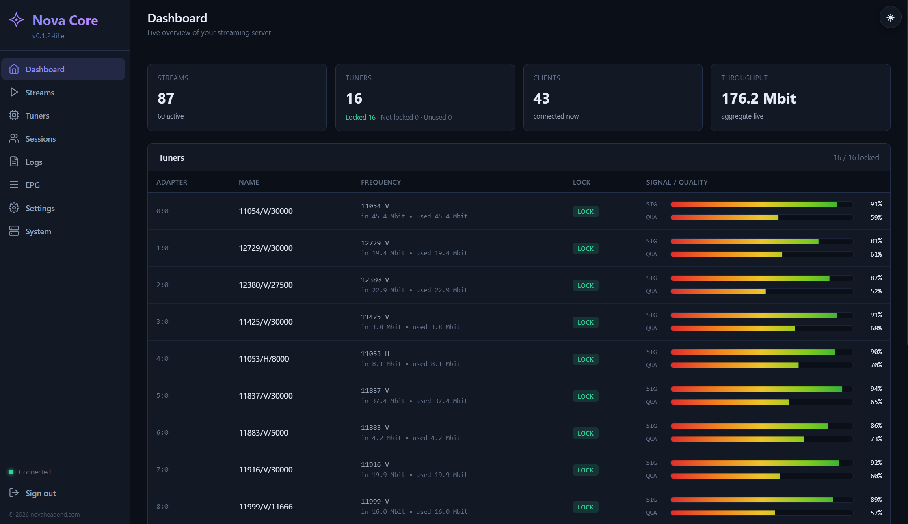

<div align="center">

# Nova Core

**DVB → IP streaming headend. One static binary. No ffmpeg, no dependencies.**

Turn DVB-S / S2 / T / T2 / C tuners into HTTP-TS and UDP streams with a modern web UI, EPG, and a built-in playlist — on a single Linux binary you install in one command.

[](https://github.com/novaheadend/nova-core-releases/releases/latest)


</div>

> A lightweight, self-hosted **IPTV streaming server** and **DVB-to-IP gateway** — a free, modern alternative to Astra (Cesbo) and Flussonic for satellite / terrestrial / cable headends.

<div align="center">

</div>

## Features

- **Tuner inputs:** DVB-S, DVB-S2, DVB-T, DVB-T2, DVB-C (full Linux DVB API, v5 signal stats)
- **Network inputs:** HTTP-TS, UDP and RTP — unicast or multicast, read natively in-process, so Nova can sit in front of a multicast backbone you already run
- **BISS descrambling:** apply the key a feed's distributor gives you (12-hex session word or 16-hex control word), using Nova dvbcsa — our own pure-Go DVB-CSA, validated byte-for-byte against libdvbcsa
- **Outputs:** HTTP-TS, UDP / multicast, and a one-click `/playlist.m3u`
- **Modern web UI** — tuners, streams, live signal / quality, client sessions, logs, EPG
- **EPG** — XMLTV harvest, plus per-channel guide binding merged into one master guide matched to the playlist (Jellyfin / Plex / TiviMate ready)
- **Channel logos** — per-channel icons downloaded once and served locally, carried in the playlist as tvg-logo
- **Single static binary** — no ffmpeg, no Python, nothing else to install; that includes the network inputs and the descrambler
- **One-command install** — systemd unit + bootstrap admin, done
- **Light on resources** — runs a 60+ stream headend on a low-power APU
- **Secure by default** — IP allow-list and brute-force-resistant admin login
- **Architectures** — Linux amd64, arm64, armv7, i386

## Requirements

- **OS:** a **systemd**-based Linux distribution. Tested on Debian 11/12 and
  Ubuntu 20.04+; works on Fedora / RHEL / Rocky / AlmaLinux, openSUSE, Arch,
  Raspberry Pi OS (64-bit) and Armbian. Non-systemd distros (Alpine, Void,
  Devuan) can run the binary manually but `-install` needs systemd.
- **Kernel DVB drivers** with your tuner exposed at `/dev/dvb/*`.
- **CPU:** x86-64-v2 (≈2009+) for the amd64 build, or arm64 / armv7 / i386 (32-bit x86, SSE2).
- **root** (install writes to `/opt/nova-core` and registers a systemd unit).
- **No** ffmpeg, Python, or libc dependency — a single static binary.

> Bare-metal recommended for DVB capture: most cards (e.g. NetUP/cx23885)
> need real PCIe DMA and do not work reliably under virtualization passthrough.

## Quick start

```sh
# Download the build for your CPU from Releases, verify, then:
tar -xzf nova-core-linux-amd64.tar.gz
sudo ./nova-core -install
# Open the URL it prints and log in with the generated admin password.
```

Uninstall any time with `sudo ./nova-core -uninstall`.

## How it compares

| | **Nova Core** | Astra (Cesbo) | Flussonic |
|---|---|---|---|
| Price | **Free core** | Commercial | Commercial ($$$) |
| Footprint | **Single binary, no deps** | Binary + Lua | Heavy install |
| DVB-S / S2 / T / T2 / C input | ✅ | ✅ | ✅ |
| HTTP-TS / UDP output | ✅ | ✅ | ✅ |
| Built-in modern web UI | ✅ | partial | ✅ |
| EPG (XMLTV) | ✅ | ✅ | ✅ |
| ARM / low-power | ✅ | partial | ❌ |

## Documentation

Full docs and the project site: **[novaheadend.com](https://novaheadend.com)**

## License

Nova Core is **proprietary software, free to use** in binary form — see [LICENSE](LICENSE). The source is not public. An **Enterprise** edition with extended integrations is available; get in touch via [novaheadend.com](https://novaheadend.com).

---

<div align="center">
<sub>Nova Core — DVB to MPEG-TS streaming headend · self-hosted IPTV server · Astra / Flussonic alternative · © novaheadend.com</sub>
</div>

## Docker

An official multi-arch image (amd64 / arm64) is published on every release:

```sh
docker run -d --name nova-core \
  --device /dev/dvb \
  -p 80:80 \
  -p 8000:8000 \
  -v nova-config:/config \
  -v nova-data:/opt/nova \
  ghcr.io/novaheadend/nova-core:latest
```

Published ports are the recommended default: `:80` is the web UI / control
API and `:8000` is the stream / playlist endpoint (M3U + XMLTV + HTTP-TS),
both plain TCP — bridge networking works for Plex, Jellyfin, Emby and any
M3U client. `--device /dev/dvb` exposes the tuners; the bootstrap admin
password is printed in `docker logs nova-core`. Tags: `:latest` and `:vX.Y.Z`.

Use `--network host` **only** if you configure a UDP / RTP multicast output
on a stream (e.g. `udp://239.1.2.3:1234`) — multicast egress doesn't cross
Docker's bridge NAT. HTTP consumers never need it.
